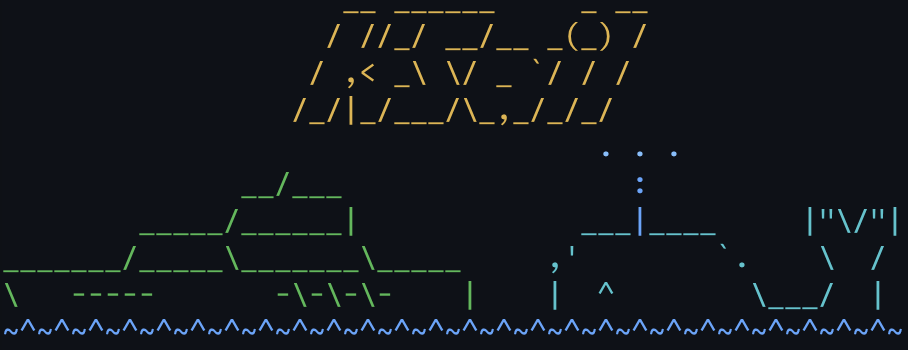

# KSail reader reference

[](https://github.com/devantler-tech/ksail/stargazers)
[](https://github.com/devantler-tech/ksail/releases/latest)
[](https://polyformproject.org/licenses/shield/1.0.0)
[](https://pkg.go.dev/github.com/devantler-tech/ksail/v7)
[](https://github.com/devantler-tech/ksail/actions/workflows/ci.yaml)
[](https://github.com/mcp)

Start with the [project README](../README.md) for a credential-free first checkpoint.
Find optional integrations, platform details and related projects here.
Contributors start with [CONTRIBUTING.md](../CONTRIBUTING.md).



KSail bundles common Kubernetes tooling into a single binary, with a CLI, VS Code extension,
AI chat interface and MCP server. A provider supplies machines or containers; a distribution
chooses the Kubernetes implementation. Local Docker clusters need a running Docker daemon;
cloud and existing-Kubernetes paths have their own prerequisites, permissions and costs.

📖 **Full documentation:** <https://ksail.devantler.tech>

## Installation options

The release installer needs a Linux/macOS shell, `curl`, `tar` and `sha256sum` or `shasum`. It verifies the release archive's
checksum before installing. For Homebrew, install Homebrew first and follow the
[tap's installation guidance](https://github.com/devantler-tech/homebrew-tap#install-the-tool-you-want),
including its cask trust step. The KSail cask removes the macOS quarantine attribute.

```sh
# Linux / macOS (checksum-verified release)
curl -fsSL https://github.com/devantler-tech/ksail/releases/latest/download/install.sh | sh

# macOS alternative
brew tap devantler-tech/tap
brew trust --cask devantler-tech/tap/ksail
brew install --cask devantler-tech/tap/ksail
```

See the [Installation Guide](https://ksail.devantler.tech/installation/) for binary downloads and more options.

## AI Assistant Plugins

Install the ksail plugin from the [devantler-tech agent plugin marketplace](https://github.com/devantler-tech/agent-plugins) for [GitHub Copilot CLI](https://docs.github.com/en/copilot/how-tos/copilot-cli) or [Claude Code](https://code.claude.com/docs/en/discover-plugins) to auto-register ksail's MCP server and a ksail expertise skill.

**Copilot CLI:**

```bash
copilot plugin marketplace add devantler-tech/agent-plugins
copilot plugin install ksail@devantler-plugins
```

**Claude Code:**

```text
/plugin marketplace add devantler-tech/agent-plugins
/plugin install ksail@devantler-plugins
```

Requires `ksail` on `PATH` plus the chosen client's own authentication/plan. These clients are
optional, not prerequisites for the README's local scaffold. Claude's slash commands belong in
its interactive client, not a shell.

If you installed the plugin earlier from this repository's own marketplace, remove that marketplace first. Its copy no longer updates, and removing the marketplace also uninstalls the plugin it provided:

- Copilot CLI: `copilot plugin marketplace remove ksail --force`
- Claude Code: `/plugin marketplace remove ksail`

## Explore your cluster

After creating the [README's local cluster](../README.md#run-the-local-cluster),
run `ksail cluster connect` from the project directory to open K9s, an interactive
terminal view of the cluster. Enter `:quit` to exit K9s. Delete the trial when finished
as described in the README.

Continue with the [Getting Started guide](https://ksail.devantler.tech/start/quickstart/) for GitOps, workloads, and multi-tenancy.

## What KSail Bundles

| Category                 | Built-in Capabilities                                                            |
|--------------------------|----------------------------------------------------------------------------------|
| Cluster Provisioning     | Kind, K3d, Talos, VCluster (Vind), KWOK (kwokctl), EKS, GKE, AKS                 |
| Container Orchestration  | kubectl, Helm, Kustomize                                                         |
| GitOps Engines           | Flux, ArgoCD                                                                     |
| Secrets Management       | SOPS with Age encryption                                                         |
| Manifest Validation      | Kubeconform                                                                      |
| Cluster Operations       | K9s, backup & restore, multi-tenancy (`ksail tenant`)                            |
| AI Integration           | Chat assistant (Copilot SDK), MCP server, VS Code extension                      |
| Infrastructure Providers | Docker (local), Kubernetes (nested), Hetzner Cloud, Sidero Omni, AWS, GCP, Azure |

See the [feature overview](https://ksail.devantler.tech/features/) and [architecture guide](https://ksail.devantler.tech/architecture/) for details.

## Supported Platforms

| OS                                                | Architecture |
|---------------------------------------------------|--------------|
| 🐧 Linux                                          | amd64, arm64 |
| 🍎 macOS                                          | arm64        |
| ⊞ Windows downloads (use WSL2 for local clusters) | amd64, arm64 |

The available provider/distribution combinations are:

| Provider                   | Distributions                                           |
|----------------------------|---------------------------------------------------------|
| Docker                     | Vanilla (Kind), K3s (K3d), Talos, VCluster (Vind), KWOK |
| Kubernetes (existing host) | Vanilla, K3s, Talos, VCluster, KWOK                     |
| Hetzner                    | Vanilla, K3s, Talos                                     |
| Omni                       | Talos                                                   |
| AWS                        | EKS                                                     |
| GCP                        | GKE                                                     |
| Azure                      | AKS                                                     |

Consult the [support matrix](https://ksail.devantler.tech/support-matrix/) and distribution guides
for component limits. Provider prerequisites differ:

- Docker needs a running local daemon.
- Kubernetes needs access to an existing host cluster and the network setup for its chosen exposure
  method (Gateway, LoadBalancer or NodePort), not local Docker.
- Hetzner needs provider credentials and distribution-specific prerequisites. Talos uses an available
  compatible ISO or a snapshot built from a Talos factory schematic. Snapshot mode needs a Talos
  version pin and supported x86 server types; see the [Hetzner guide](https://ksail.devantler.tech/providers/hetzner/).
- Omni needs an account, service credentials and its configured API endpoint.
- EKS needs AWS credentials/permissions and an external `eksctl` binary, which KSail does not embed.
- GKE needs Google Application Default Credentials and project/location configuration.
- AKS needs Azure-resolvable credentials and subscription/resource-group configuration.

Use [Choose your setup](https://ksail.devantler.tech/distributions/) to find each provider's guide before creating
resources. Managed cluster support does not imply all KSail component installers or
experimental add-ons are supported. GKE and AKS currently show an unknown provider status in
`ksail cluster info`; use their provider consoles for that status.
KWOK simulates pods and nodes; it does not run real workloads
or reconcile GitOps. Cloud resources incur provider charges until cleaned up.

## Community & Support

- 💬 **[GitHub Discussions](https://github.com/devantler-tech/ksail/discussions)** — questions, ideas, and community
- 🐛 **[Issue Tracker](https://github.com/devantler-tech/ksail/issues)** — bugs and feature requests
- 📖 **[Documentation](https://ksail.devantler.tech)** — guides, CLI reference, architecture
- 🎓 **[Resources](https://ksail.devantler.tech/resources/)** — presentations, blog posts, tutorials
- ⭐ **[Star the repo](https://github.com/devantler-tech/ksail)** — help others discover KSail

## Contributing

Contributions are welcome! See [CONTRIBUTING.md](../CONTRIBUTING.md) for the development process, coding standards, and PR guidelines. Start with issues labeled [`good first issue`](https://github.com/devantler-tech/ksail/issues?q=is%3Aissue+is%3Aopen+label%3A%22good+first+issue%22).

## Related Projects

| Project                                                               | Description                                   | Type     |
|-----------------------------------------------------------------------|-----------------------------------------------|----------|
| [devantler-tech/platform](https://github.com/devantler-tech/platform) | The maintainer's personal kubernetes platform | Platform |

Using KSail in your project? Open a PR to add it here.

## License

KSail is licensed under the **[PolyForm Shield License 1.0.0](../LICENSE)**, not an unrestricted
open-source license. Its noncompetition condition covers KSail and products the licensor or its
affiliates provide using the software; redistribution has notice obligations. Read the full
[license terms](../LICENSE) before using, embedding, modifying or redistributing it. This guide
does not grant additional rights or replace those terms. The
[Licensing FAQ](https://ksail.devantler.tech/faq/#licensing) provides additional project context.

## Star History

<a href="https://www.star-history.com/#devantler-tech/ksail&type=timeline&legend=top-left">
 <picture>
   <source media="(prefers-color-scheme: dark)" srcset="https://api.star-history.com/svg?repos=devantler-tech/ksail&type=timeline&theme=dark&legend=top-left" />
   <source media="(prefers-color-scheme: light)" srcset="https://api.star-history.com/svg?repos=devantler-tech/ksail&type=timeline&legend=top-left" />
   
 </picture>
</a>
